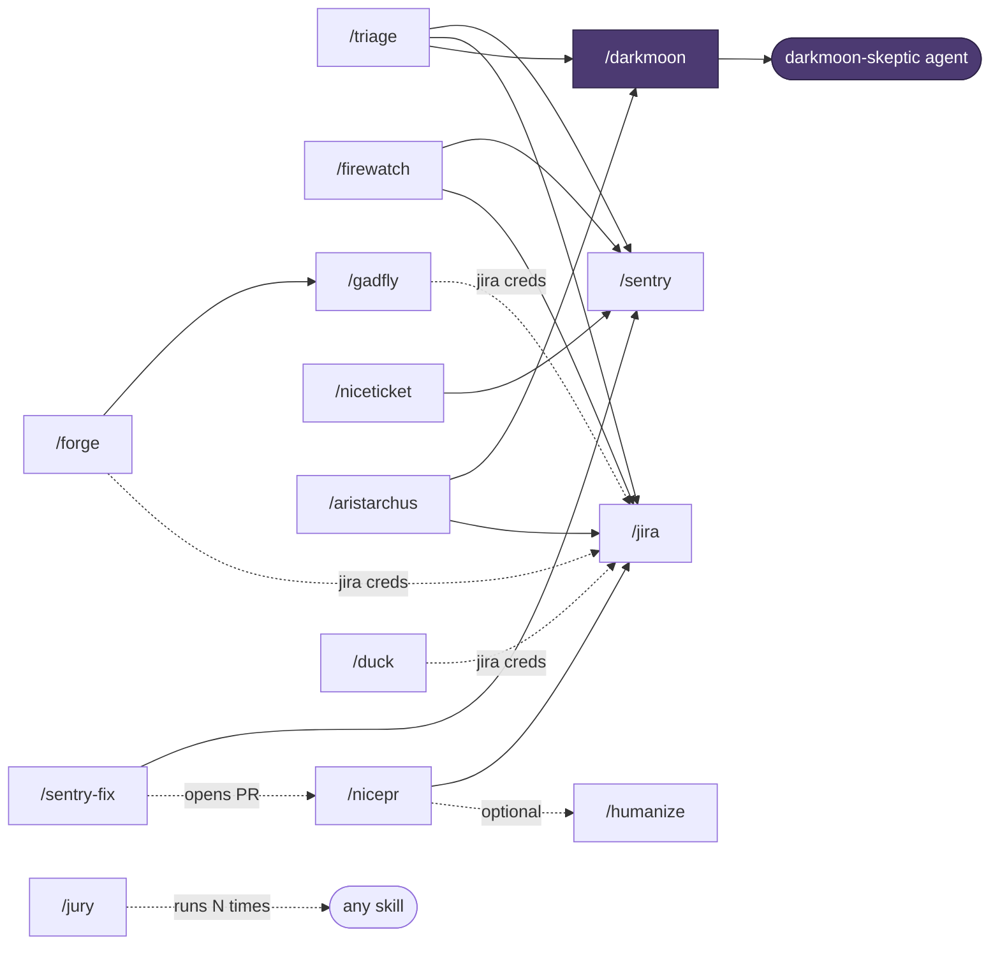

[](https://github.com/sgtlaugh/skills/actions/workflows/test.yml)
[](LICENSE)

# 🌑 skills

```
     ░▒▓ skills ▓▒░
  liar ahead. try grep.
```

Claude Code skills that make the agent prove it.

- **Evidence or nothing:** every verdict cites a grep, a query or a `file:line`, or says `Can't-determine`.
- **Fresh eyes:** reviews run in a separate context, so the author's reasoning can't wave its own work through.

## Install

1. Clone the repo and run the installer:

   ```bash
   git clone https://github.com/sgtlaugh/skills.git ~/Github/skills
   ~/Github/skills/install.sh
   ```

2. Read its checklist. Skills with nothing in their **Needs** column work now; each ⚠ line says what the rest are missing:

   ```text
   Config → ~/.config/claude-skills
     ⚠ credentials.json  2 of 10 keys set
     ⚠ services.md       still the template
   Environment
     ⚠ gh                not logged in - run gh auth login → /aristarchus, /nicepr, /triage, /sentry-fix
   ```

3. Set up only what your skills need:
   - **Jira, Sentry, alert keys:** add them to `~/.config/claude-skills/credentials.json`, which the installer created (mode 600). Where to get each one is under *Config files and credential keys* below.

     ```json
     { "jiraBaseUrl": "https://acme.atlassian.net", "jiraEmail": "you@acme.com", "jiraApiToken": "<token>" }
     ```

   - **gh:** `gh auth login`
   - **`$WORKSPACE`:** `export WORKSPACE=~/code` in your shell profile, the folder holding your clones
   - **`services.md`:** fill in the template in the same folder: your repos, log search and test commands

4. Re-run `install.sh` until the checklist is green, then restart Claude Code and type `/`. Re-run it after every pull.

Every skill needs Claude Code, jq and curl 7.76+, on Linux or macOS with bash 3.2+. Common usage is in [`CHEATSHEET.md`](CHEATSHEET.md); every flag is in each skill's `SKILL.md`.

<details>
<summary>Config files and credential keys</summary>

Up to four files live in `~/.config/claude-skills/`. `install.sh` creates the first two if they're missing, never overwrites them, and backs up anything in its way to `.bak`. Skills that need none of them work right after install.

| File | Created by `install.sh` | Used by | Holds |
|---|---|---|---|
| `credentials.json` | yes (mode 600) | the API skills | API tokens (keys below) |
| `services.md` | yes | `/sentry`, `/sentry-fix`, `/triage`, `/firewatch`, `/aristarchus` | *Your* systems: repos, log search, alert patterns, test commands |
| `voice.md` | no | `/humanize` | *Your* voice for GitHub text |
| `work.json` | no | `/nicepr` | `{"reviewers": [...]}` for `--create` |

- **`credentials.json`** lives elsewhere if `CLAUDE_SKILLS_CREDENTIALS` points there.
- **`services.md`** says which repo each Sentry project lives in, your log search skill, your alert patterns and how to run each repo's tests. It starts as a template whose values read `<your ...>`; skills treat those as missing and ask, so fill in the sections your skills use.
- **`voice.md`** holds how you suggest, push back and approve.
- **`work.json`**'s reviewers are asked to review a PR `/nicepr --create` opens, unless it's a draft.

**`credentials.json` keys**

| Key | Used by | Where to get it |
|---|---|---|
| `datadogPAT` | `/firewatch` | Datadog → Personal Access Tokens |
| `datadogSite` | `/firewatch` | Your Datadog site, e.g. `datadoghq.com` |
| `jenkinsApiToken` | `/firewatch` | Jenkins → your user → Configure → API Token |
| `jenkinsUser` | `/firewatch` | Your Jenkins username |
| `jiraApiToken` | `/jira`, `/gadfly`, `/forge`, `/duck`, `/nicepr`, `/aristarchus`, `/triage`, `/firewatch` | [Atlassian API tokens](https://id.atlassian.com/manage-profile/security/api-tokens) |
| `jiraBaseUrl` | `/jira`, `/gadfly`, `/forge`, `/duck`, `/nicepr`, `/aristarchus`, `/triage`, `/firewatch` | Your Atlassian site, e.g. `https://acme.atlassian.net` |
| `jiraEmail` | `/jira`, `/gadfly`, `/forge`, `/duck`, `/nicepr`, `/aristarchus`, `/triage`, `/firewatch` | Your Atlassian email |
| `opsgenieApiKey` | `/firewatch` | Opsgenie → Settings → API key management |
| `sentryAuthToken` | `/sentry`, `/sentry-fix`, `/triage`, `/firewatch`, `/niceticket` | Sentry → Settings → Auth Tokens (`org:read`, `project:read`, `event:read`) |
| `sentryOrg` | `/sentry`, `/sentry-fix`, `/triage`, `/firewatch`, `/niceticket` | Your Sentry org slug |

Skills that call `/jira` or `/sentry` use these keys through them. Two optional keys: `opsgenieApiBase` for an EU Opsgenie account, `sentryApiBase` for a self-hosted Sentry.

</details>

## The skills

| Skill | What it does | Needs |
|---|---|---|
| **Review** | | |
| [`/occam`](skills/occam/SKILL.md) | Fresh-context review of your uncommitted change | |
| [`/aristarchus`](skills/aristarchus/SKILL.md) | Deep PR review, every finding verified by `/darkmoon` | gh, `$WORKSPACE` |
| [`/nicepr`](skills/nicepr/SKILL.md) | PR title and description from the diff and ticket | gh |
| [`/niceticket`](skills/niceticket/SKILL.md) | Short, well-formatted Jira bug ticket from the facts | |
| **Verify** | | |
| [`/darkmoon`](skills/darkmoon/SKILL.md) | An independent skeptic checks claims against the code | |
| [`/solaire`](skills/solaire/SKILL.md) | Grounding checks to run before a research answer | |
| **Build** | | |
| [`/bonfire`](skills/bonfire/SKILL.md) | Test-first loop: failing test, least code, refactor | pytest |
| [`/duck`](skills/duck/SKILL.md) | A sarcastic rubber duck that asks until you see the bug | |
| **Design** | | |
| [`/gadfly`](skills/gadfly/SKILL.md) | Attacks a tech spec before it gets built | |
| [`/forge`](skills/forge/SKILL.md) | Turns a PRD into a grounded spec draft | |
| [`/dialectic`](skills/dialectic/SKILL.md) | Argues each option, then names the trade-off | |
| **Production** | | |
| [`/firewatch`](skills/firewatch/SKILL.md) | Investigates a production alert, severity first | alert keys, `services.md` |
| [`/sentry`](skills/sentry/SKILL.md) | Deep-dives a Sentry issue at the deployed release | Sentry, `services.md` |
| [`/sentry-fix`](skills/sentry-fix/SKILL.md) | A Sentry issue to a tested fix on a branch | Sentry, gh, `services.md`, `$WORKSPACE` |
| [`/triage`](skills/triage/SKILL.md) | A ticket to a proven root cause or an answer | Jira, Sentry, gh, `services.md`, `$WORKSPACE` |
| [`/jira`](skills/jira/SKILL.md) | Creates, searches and updates Jira tickets and Confluence pages | Jira |
| **Meta** | | |
| [`/kiln`](skills/kiln/SKILL.md) | Lints a SKILL.md for rules that won't bind | |
| [`/jury`](skills/jury/SKILL.md) | Runs a skill N times and compares the runs | |
| [`/velka`](skills/velka/SKILL.md) | Mines your past sessions for habits | |
| [`/humanize`](skills/humanize/SKILL.md) | Strips AI writing patterns from text | |

Optional extras, used when present: Jira keys for ticket context in the review and spec skills, `voice.md` for `/humanize`, `work.json` for `/nicepr --create` reviewers, pandoc for documents in `/jira`, `/gadfly`, `/forge` and `/dialectic`.

## Example verdict

`/darkmoon --claims` on a repo built to fool a grep (trimmed):

```
## 🌑 darkmoon - judgment on 7 claims

| # | Claim                                 | Verdict         | Evidence                                                     |
|---|---------------------------------------|-----------------|--------------------------------------------------------------|
| 2 | issue_refund is never called          | Refuted ✗       | api.py:1 imports it `as give_back`; api.py:5 calls give_back |
| 3 | handle_chargeback is dead code        | Refuted ✗       | handlers.py:3 getattr(self, f"handle_{event}") reaches it    |
| 4 | The repo never imports pickle         | Upheld ✓        | grep -rniE 'pickle|__import__' → no output                   |
| 6 | The refund endpoint logged no errors  | Can't-determine | needs the production logs; the repo can't show it            |

Verdict: 4 refuted · 0 weak · 2 upheld · 1 can't-determine.
```

## How skills connect

Skills hand off to each other instead of repeating work. `/darkmoon` is the shared verifier.



## Tests

| Suite | Command | Cost | Checks |
|---|---|---|---|
| Shell tests | `bash tests/run.sh` | free | Scripts, hooks and `install.sh`; runs in CI |
| `/darkmoon` eval | `evals/darkmoon/run.sh -n 2` | $2 | Verdicts on trap claims with known answers |
| Review eval | `evals/review/run.sh -n 2` | $4 | `/occam` and the Saboteur lens on planted bugs |

Run the shell tests on every change, and an eval before and after changing the skill it covers. CI also scans the full history for secrets with [gitleaks](https://github.com/gitleaks/gitleaks).

## Uninstall

Remove the links `install.sh` made in `~/.claude/`:

```bash
cd ~/Github/skills && find ~/.claude -lname "$PWD/*" -delete && find ~/.claude/skills -type d -empty -delete
```

This keeps the following, for you to delete by hand if you want:

- **Config:** `~/.config/claude-skills/`
- **Reports and caches:** `~/.claude/reports/`, `~/.claude/jury-runs/`, `~/.claude/velka/`

---

MIT licensed. Praise the Sun \\[T]/
