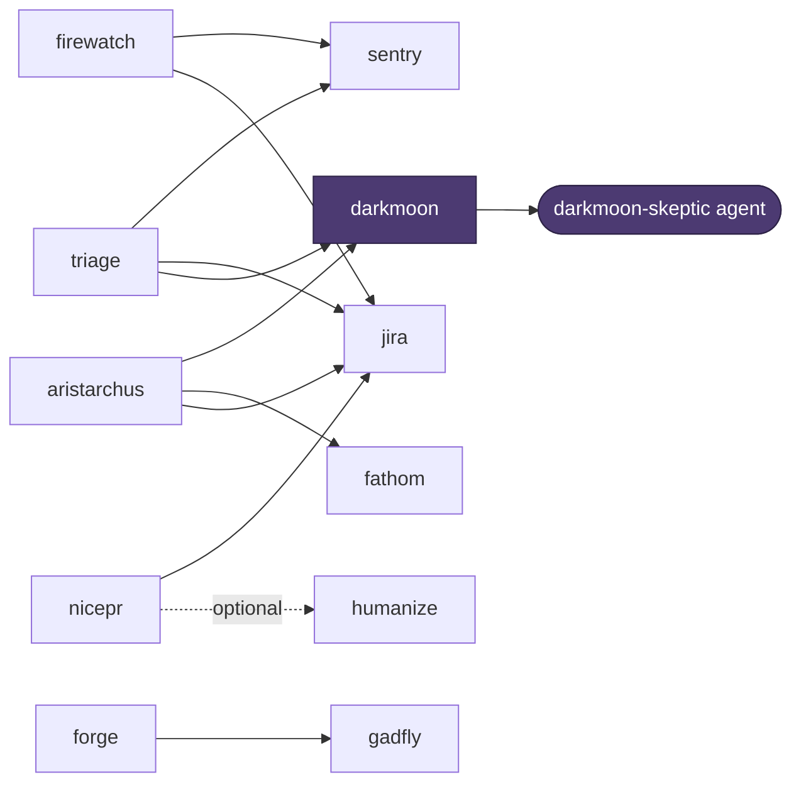

[](https://github.com/sgtlaugh/skills/actions/workflows/test.yml)
[](LICENSE)

# skills

> *Liar ahead. Therefore, try grep.*

Claude Code skills that make the agent prove it. Every verdict ships with its evidence (a grep, a query, a `file:line`) or says `Can't-determine`. Reviews run in a fresh context so the author's reasoning can't wave its own work through. Review and investigation skills are read-only; the ones that build (bonfire, forge, nicepr `--create`, jira create) write only what you asked for.

## Contents

- [Quick start](#quick-start)
- [The skills](#the-skills)
- [How they connect](#how-they-connect)
- [Configuration](#configuration)
- [Requirements](#requirements)
- [Tests](#tests)

## Quick start

```bash
git clone https://github.com/sgtlaugh/skills.git ~/Github/skills
cd ~/Github/skills
./install.sh
```

`install.sh` symlinks every skill, agent and hook into `~/.claude/`, then seeds `~/.config/claude-skills/` with the two config templates. Re-run it after a pull. It never overwrites your config, and a real file in the way is backed up to `.bak` first.

Restart Claude Code, then type `/` to see the skills. Usage patterns for each are in [`CHEATSHEET.md`](CHEATSHEET.md).

## The skills

**Before you push**

| Skill | What it does |
|---|---|
| [`/occam`](skills/occam/SKILL.md) | Reviews your own change in a fresh context: bugs, drift (leftover old logic, stale docs and callers), simplifications, and whether the diff is the minimal one |
| [`/aristarchus`](skills/aristarchus/SKILL.md) | Deep PR review: ticket context, stack-aware traps, five independent lenses, then darkmoon checks the findings |
| [`/nicepr`](skills/nicepr/SKILL.md) | Short, human PR titles and descriptions from the branch diff and the ticket |

**Checking claims**

| Skill | What it does |
|---|---|
| [`/darkmoon`](skills/darkmoon/SKILL.md) | Summons an independent skeptic to challenge the last answer. Each claim is upheld, refuted with evidence, or marked can't-determine. It never invents a counter-argument |
| [`/litmus`](skills/litmus/SKILL.md) | Settles one specific claim against the code: Confirmed, Refuted or Can't-determine, with the deterministic evidence shown |
| [`/solaire`](skills/solaire/SKILL.md) | Run it *before* a research or feasibility question. Seven fixed checks keep the answer grounded the first time. Jolly cooperation \[T]/ |

**Building and debugging**

| Skill | What it does |
|---|---|
| [`/bonfire`](skills/bonfire/SKILL.md) | Test-first loop: a failing test you watch fail for the right reason, minimal code to pass, refactor only when green (pytest) |
| [`/duck`](skills/duck/SKILL.md) | A sarcastic Socratic rubber duck. Asks code-grounded questions until you find the bug yourself. `--quack` drops the act and proves the cause with a repro |
| [`/fathom`](skills/fathom/SKILL.md) | Deep-module design lens: is this module deep or shallow, and how to deepen it. `--twice` designs an interface several ways and compares them |

**Specs and decisions**

| Skill | What it does |
|---|---|
| [`/gadfly`](skills/gadfly/SKILL.md) | Interrogates a tech spec before it gets built: requirement gaps, grounding in the real code, four adversarial lenses. `--prd` checks the HOW against the WHY |
| [`/forge`](skills/forge/SKILL.md) | Turns a PRD into a grounded tech-spec draft, stops to let you decide the design forks, then has an independent gadfly pass critique it |
| [`/dialectic`](skills/dialectic/SKILL.md) | Argues each option to win, cross-examines them, then a judge names the real trade-off and the condition that would flip the call |

**Production**

| Skill | What it does |
|---|---|
| [`/firewatch`](skills/firewatch/SKILL.md) | Alert investigation: severity first, known patterns, logs, Sentry, Datadog APM, Jenkins and Opsgenie history, then a report with every claim tagged |
| [`/sentry`](skills/sentry/SKILL.md) | Issue deep-dive (stack trace at the deployed release, breadcrumbs, who is affected), top and new issues, search, and `fixed` to check whether a deploy stopped an issue |
| [`/triage`](skills/triage/SKILL.md) | Takes a ticket to a proven root cause: evidence ledger, competing causes decided by running their checks, darkmoon verification, and a note ready to post |
| [`/jira`](skills/jira/SKILL.md) | Create, search and update Jira tickets; fetch Confluence pages as readable text |

**About skills themselves**

| Skill | What it does |
|---|---|
| [`/kiln`](skills/kiln/SKILL.md) | Lints a SKILL.md for the flaws that quietly weaken it: rules that won't bind, contradictions, stale references, no output contract |
| [`/jury`](skills/jury/SKILL.md) | Runs any skill N times in parallel and merges the results into a frequency table, so you can see what was consistent and what was luck |
| [`/velka`](skills/velka/SKILL.md) | Reads your past session transcripts (mechanically, no LLM) and reports recurring habits worth fixing or turning into a skill |
| [`/humanize`](skills/humanize/SKILL.md) | Strips AI writing patterns from text. `--concise` also cuts it roughly in half |

## How they connect

Several skills hand off to others instead of re-implementing them. darkmoon is the shared verifier.



darkmoon spawns the `darkmoon-skeptic` agent in a fresh context. The agent runs behind a `PreToolUse` hook ([`hooks/darkmoon-readonly.sh`](hooks/darkmoon-readonly.sh)) that blocks anything outside a read-command allowlist, so a skeptic can look but not touch. It is a tripwire, not a sandbox.

## Configuration

Two files live in `~/.config/claude-skills/`. `install.sh` creates both from the templates if they don't exist.

**`credentials.json`** (mode 600) holds tokens for the skills that call an API. Set `CLAUDE_SKILLS_CREDENTIALS` to keep it elsewhere.

| Key | Used by | Where to get it |
|---|---|---|
| `datadogPAT`, `datadogSite` | `/firewatch` | Datadog → Personal Access Tokens (read scopes); site such as `datadoghq.com` or `datadoghq.eu` |
| `jenkinsUser`, `jenkinsApiToken` | `/firewatch` | Jenkins → your user → Configure → API Token |
| `jiraApiToken`, `jiraBaseUrl`, `jiraEmail` | `/jira`, `/gadfly`, `/duck`; others through `/jira` | [Atlassian API tokens](https://id.atlassian.com/manage-profile/security/api-tokens); your site URL and email |
| `opsgenieApiKey` | `/firewatch` | Opsgenie → Settings → API key management (read access) |
| `sentryAuthToken`, `sentryOrg` | `/sentry`; triage and firewatch through it | Sentry → Settings → Auth Tokens (`org:read`, `project:read`, `event:read`); your org slug |
| `opsgenieApiBase`, `sentryApiBase` | optional | Only for an EU Opsgenie account or a self-hosted Sentry. Defaults: `https://api.opsgenie.com`, `https://sentry.io/api/0` |

**`services.md`** is the service catalog, the facts about *your* systems that sentry, triage and firewatch need: which repo a Sentry project lives in, your log search skill, alert patterns, Jenkins and Datadog naming, health-check queries. Fill in what applies and leave the rest. A skill that needs a missing value asks instead of guessing. See [`services.example.md`](services.example.md).

Skills that need no config work right after install.

## Requirements

| Tool | Needed for |
|---|---|
| [Claude Code](https://docs.claude.com/en/docs/claude-code) | everything |
| [jq](https://jqlang.github.io/jq/) | install, darkmoon, velka, and every skill that calls an API |
| [gh](https://cli.github.com/) | PR and code-history work: aristarchus, nicepr, triage, sentry, firewatch, litmus |
| curl | the API skills |
| [pandoc](https://pandoc.org/) | document conversion in jira, gadfly, forge, dialectic |
| python + [pytest](https://pytest.org/) | bonfire, and duck's `--quack` repro |

Written for Linux and macOS (bash 3.2+, GNU or BSD find); CI runs on Linux.

## Tests

```bash
bash tests/run.sh
```

Covers the shell parts: darkmoon's transcript extractor and read-only hook, velka's digest and collector, `install.sh`, and the agent-to-hook wiring. CI runs the same suite on every push that touches them, and scans the full history for secrets with [gitleaks](https://github.com/gitleaks/gitleaks) on every push.

Skills themselves are prompts, so they are tested by running them on real inputs. `/kiln` checks structure, `/jury` checks consistency.

---

MIT licensed. Praise the Sun \[T]/
