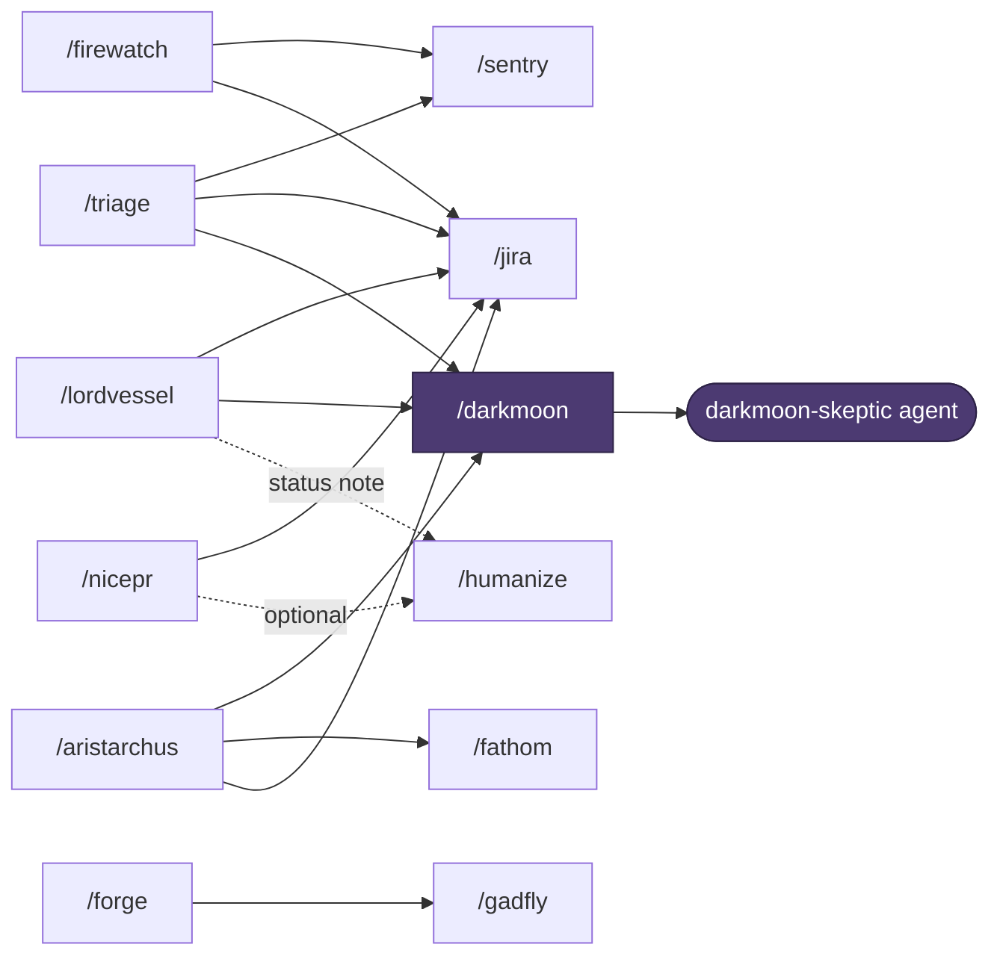

[](https://github.com/sgtlaugh/skills/actions/workflows/test.yml)
[](LICENSE)

# 🌑 skills

```
     ░▒▓ skills ▓▒░
  liar ahead. try grep.
```

Claude Code skills that make the agent prove it.

- **Evidence or nothing:** every verdict cites a grep, a query or a `file:line`, or says `Can't-determine`.
- **Fresh eyes:** reviews run in a separate context, so the author's reasoning can't wave its own work through.

## Contents

- [Quick start](#quick-start)
- [The skills](#the-skills)
- [Example verdict](#example-verdict)
- [How they connect](#how-they-connect)
- [Configuration](#configuration)
- [Requirements](#requirements)
- [Tests](#tests)
- [Uninstall](#uninstall)

## Quick start

```bash
git clone https://github.com/sgtlaugh/skills.git ~/Github/skills && ~/Github/skills/install.sh
```

Restart Claude Code and type `/`. Re-run `install.sh` after each pull. Every flag is in [`CHEATSHEET.md`](CHEATSHEET.md).

## The skills

### Before you push

| Skill | What it does |
|---|---|
| [`/occam`](skills/occam/SKILL.md) | Reviews your change in a fresh context for bugs, leftovers and simplicity |
| [`/aristarchus`](skills/aristarchus/SKILL.md) | Deep PR review through five independent lenses, then `/darkmoon` checks the findings |
| [`/nicepr`](skills/nicepr/SKILL.md) | Writes short, human PR titles and descriptions from the diff and the ticket |

### Checking claims

| Skill | What it does |
|---|---|
| [`/darkmoon`](skills/darkmoon/SKILL.md) | An independent skeptic checks the last answer, or claims you give it, against the code |
| [`/solaire`](skills/solaire/SKILL.md) | Run it before a research question. Seven fixed checks keep the answer grounded \\[T]/ |

### Building and debugging

| Skill | What it does |
|---|---|
| [`/bonfire`](skills/bonfire/SKILL.md) | Test-first loop: watch the test fail, write the least code to pass, refactor when green |
| [`/duck`](skills/duck/SKILL.md) | A sarcastic rubber duck that asks questions until you find the bug yourself |
| [`/fathom`](skills/fathom/SKILL.md) | Judges whether a module is deep or shallow, and how to deepen it |

### Specs and decisions

| Skill | What it does |
|---|---|
| [`/gadfly`](skills/gadfly/SKILL.md) | Attacks a tech spec before it's built: gaps, grounding in real code, four adversarial lenses |
| [`/forge`](skills/forge/SKILL.md) | Turns a PRD into a grounded spec draft. You decide the forks, then `/gadfly` critiques it |
| [`/dialectic`](skills/dialectic/SKILL.md) | Argues each option to win, then a judge names the trade-off and what would flip it |

### Production

| Skill | What it does |
|---|---|
| [`/firewatch`](skills/firewatch/SKILL.md) | Investigates an alert: severity first, then logs, Sentry, APM and alert history |
| [`/sentry`](skills/sentry/SKILL.md) | Deep-dives a Sentry issue at the deployed release, and checks whether a deploy fixed it |
| [`/triage`](skills/triage/SKILL.md) | Takes a ticket to a proven root cause, with a note ready to post |
| [`/lordvessel`](skills/lordvessel/SKILL.md) | Checks a ticket against its PRs: each requirement traced to code or marked missing, open questions and threads, a status note ready to post |
| [`/jira`](skills/jira/SKILL.md) | Creates, searches and updates Jira tickets, and reads Confluence pages |

### About skills themselves

| Skill | What it does |
|---|---|
| [`/kiln`](skills/kiln/SKILL.md) | Lints a SKILL.md for rules that won't bind, contradictions and stale references |
| [`/jury`](skills/jury/SKILL.md) | Runs a skill N times and shows which findings were consistent and which were luck |
| [`/velka`](skills/velka/SKILL.md) | Reads your past sessions and reports habits worth fixing or automating (digested mechanically, no LLM). `--propose` turns repeated pushback into CLAUDE.md edits |
| [`/humanize`](skills/humanize/SKILL.md) | Strips AI writing patterns from text, and gates text headed for GitHub against a house style |

Review skills never touch your code. `/bonfire`, `/duck --quack` and `/nicepr --create` write only what you ask for. `/gadfly`, `/forge`, `/dialectic` and `/jury` save their reports under `~/.claude/`.

## Example verdict

`/darkmoon --claims` on a repo built to fool a grep (trimmed):

```
## 🌑 darkmoon - judgment on 7 claims

| # | Claim                                 | Verdict   | Evidence                                                     |
|---|---------------------------------------|-----------|--------------------------------------------------------------|
| 2 | issue_refund is never called          | Refuted ✗ | api.py:1 imports it `as give_back`; api.py:5 calls give_back |
| 3 | handle_chargeback is dead code        | Refuted ✗ | handlers.py:3 getattr(self, f"handle_{event}") reaches it    |
| 4 | The repo never imports pickle         | Upheld ✓  | grep -rniE 'pickle|__import__' → no output                   |

Verdict: 4 refuted · 0 weak · 2 upheld · 1 can't-determine.
```

## How they connect

Skills hand off to each other instead of repeating work. `/darkmoon` is the shared verifier.



`/darkmoon` runs its skeptic agent in a fresh context. A hook ([`hooks/darkmoon-readonly.sh`](hooks/darkmoon-readonly.sh)) blocks any command outside a read-only allowlist. It's a tripwire, not a sandbox.

## Configuration

Two files live in `~/.config/claude-skills/`. `install.sh` creates both if they're missing. It never overwrites them, and backs up anything in its way to `.bak`. Skills that need neither work right after install.

**`credentials.json`** holds API tokens, mode 600. Set `CLAUDE_SKILLS_CREDENTIALS` to keep it elsewhere.

| Key | Used by | Where to get it |
|---|---|---|
| `datadogPAT` | `/firewatch` | Datadog → Personal Access Tokens |
| `datadogSite` | `/firewatch` | Your Datadog site, e.g. `datadoghq.com` |
| `jenkinsApiToken` | `/firewatch` | Jenkins → your user → Configure → API Token |
| `jenkinsUser` | `/firewatch` | Your Jenkins username |
| `jiraApiToken` | `/jira`, `/gadfly`, `/forge`, `/duck`, `/lordvessel` | [Atlassian API tokens](https://id.atlassian.com/manage-profile/security/api-tokens) |
| `jiraBaseUrl` | `/jira`, `/gadfly`, `/forge`, `/duck`, `/lordvessel` | Your Atlassian site, e.g. `https://acme.atlassian.net` |
| `jiraEmail` | `/jira`, `/gadfly`, `/forge`, `/duck`, `/lordvessel` | Your Atlassian email |
| `opsgenieApiKey` | `/firewatch` | Opsgenie → Settings → API key management |
| `sentryAuthToken` | `/sentry` | Sentry → Settings → Auth Tokens (`org:read`, `project:read`, `event:read`) |
| `sentryOrg` | `/sentry` | Your Sentry org slug |

Skills that call `/jira` or `/sentry` use these keys through them. Two optional keys: `opsgenieApiBase` for an EU Opsgenie account, `sentryApiBase` for a self-hosted Sentry.

**`services.md`** describes *your* systems: which repo each Sentry project lives in, your log search skill, alert patterns. `/sentry`, `/triage` and `/firewatch` read it. If a value is missing, the skill asks instead of guessing. Start from [`services.example.md`](services.example.md).

## Requirements

| Tool | Needed for |
|---|---|
| [Claude Code](https://docs.claude.com/en/docs/claude-code) | Everything |
| [jq](https://jqlang.github.io/jq/) | `install.sh`, `/darkmoon`, `/velka` and the API skills |
| [gh](https://cli.github.com/) | `/aristarchus`, `/nicepr`, `/triage`, `/lordvessel`, `/sentry`, `/firewatch`, `/darkmoon` |
| curl 7.76+ | The API skills (they use `--fail-with-body`) |
| [pandoc](https://pandoc.org/) | Document conversion in `/jira`, `/gadfly`, `/forge`, `/dialectic` |
| python + [pytest](https://pytest.org/) | `/bonfire` and `/duck --quack` |

Linux and macOS, bash 3.2 or newer.

## Tests

### Shell tests

```bash
bash tests/run.sh
```

Covers `/darkmoon`'s extractor and hook, `/velka`'s scripts and quote check, `/humanize`'s voice gate, `/aristarchus`'s findings parser, `install.sh`, and the agent-to-hook wiring. CI runs them on Linux and on macOS's stock bash. It also scans the full history for secrets with [gitleaks](https://github.com/gitleaks/gitleaks).

### `/darkmoon` eval

```bash
evals/darkmoon/run.sh -n 2
```

Runs claims with known answers against a fixture repo full of traps, and scores each verdict PASS, SOFT or FAIL.

- **Manual, not CI:** it calls headless Claude, about $2 a pass.
- **When:** before and after any change to the skeptic.
- **Watch SOFT, not just FAIL:** a rule that softens real evidence into "argument, not proof" shows up there first.

### Review eval

```bash
evals/review/run.sh -n 2
```

Applies planted diffs to a small fixture repo and runs `/occam` and `/aristarchus`'s Saboteur lens on each. A case lists what the review must find, the false positives it must avoid, and how many times one defect may be reported.

- **Manual, not CI:** about $4-5 a pass.
- **When:** before and after any change to occam's reviewer brief or the aristarchus lenses. The Saboteur brief is read from the skill at run time.

The skills themselves are prompts. `/kiln` checks their structure; `/jury` checks their consistency.

## Uninstall

`install.sh` links everything into `~/.claude/`. To uninstall, delete those links. Your config in `~/.config/claude-skills/` stays. Reports and caches stay too, for you to delete if you want: `~/.claude/reports/`, `~/.claude/jury-runs/` and `~/.claude/velka/`.

```bash
cd ~/Github/skills && find ~/.claude -lname "$PWD/*" -delete && find ~/.claude/skills -type d -empty -delete
```

---

MIT licensed. Praise the Sun \\[T]/
