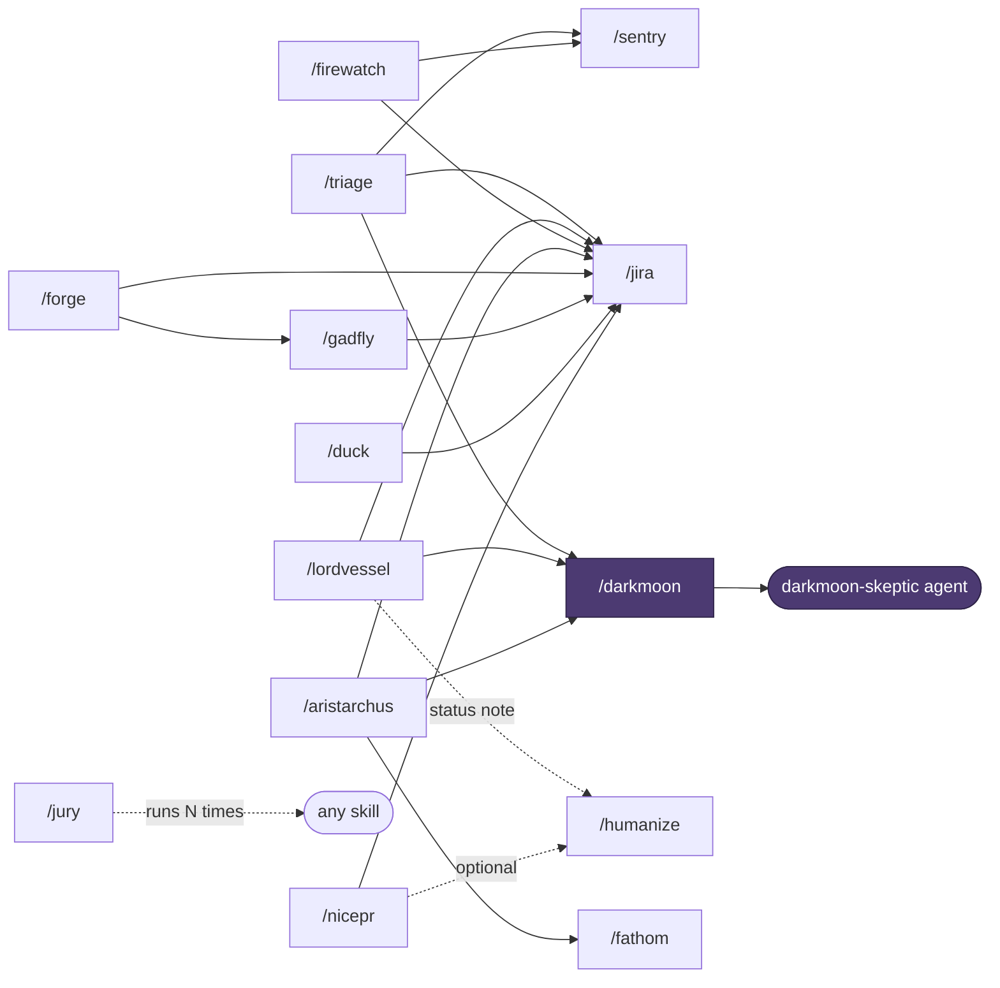

[](https://github.com/sgtlaugh/skills/actions/workflows/test.yml)
[](LICENSE)

# 🌑 skills

```
     ░▒▓ skills ▓▒░
  liar ahead. try grep.
```

Claude Code skills that make the agent prove it.

- **Evidence or nothing:** every verdict cites a grep, a query or a `file:line`, or says `Can't-determine`.
- **Fresh eyes:** reviews run in a separate context, so the author's reasoning can't wave its own work through.

## Quick start

```bash
git clone https://github.com/sgtlaugh/skills.git ~/Github/skills && ~/Github/skills/install.sh
```

Restart Claude Code and type `/`. Re-run `install.sh` after each pull. Common usage is in [`CHEATSHEET.md`](CHEATSHEET.md); every flag is in each skill's `SKILL.md`.

> [!NOTE]
> Review skills never touch your code. `/bonfire`, `/duck --quack` and `/nicepr --create` write only what you ask for, and `/jira` writes only after you say yes to a preview. `/gadfly`, `/forge`, `/dialectic` and `/jury` save their reports under `~/.claude/`.

## The skills

| Skill | What it does |
|---|---|
| **Before you push** | |
| [`/occam`](skills/occam/SKILL.md) | Reviews your change in a fresh context for bugs, leftovers and simplicity |
| [`/aristarchus`](skills/aristarchus/SKILL.md) | Deep PR review: five independent lenses, findings verified by `/darkmoon` |
| [`/nicepr`](skills/nicepr/SKILL.md) | Short, human PR titles and descriptions from the diff and the ticket |
| **Checking claims** | |
| [`/darkmoon`](skills/darkmoon/SKILL.md) | An independent skeptic checks the last answer, or your claims, against the code |
| [`/solaire`](skills/solaire/SKILL.md) | Run before a research question: seven fixed checks keep the answer grounded |
| **Building and debugging** | |
| [`/bonfire`](skills/bonfire/SKILL.md) | Test-first: watch the test fail, write the least code to pass, refactor when green |
| [`/duck`](skills/duck/SKILL.md) | A sarcastic rubber duck that questions you until you find the bug yourself |
| [`/fathom`](skills/fathom/SKILL.md) | Judges whether a module is deep or shallow, and how to deepen it |
| **Specs and decisions** | |
| [`/gadfly`](skills/gadfly/SKILL.md) | Attacks a tech spec before it's built: gaps, grounding in real code, four lenses |
| [`/forge`](skills/forge/SKILL.md) | Turns a PRD into a grounded spec draft; you decide the forks, `/gadfly` critiques |
| [`/dialectic`](skills/dialectic/SKILL.md) | Argues each option to win, then names the trade-off and what would flip it |
| **Production** | |
| [`/firewatch`](skills/firewatch/SKILL.md) | Investigates an alert: severity first, then logs, Sentry, APM, alert history |
| [`/sentry`](skills/sentry/SKILL.md) | Deep-dives a Sentry issue at the deployed release; checks if a deploy fixed it |
| [`/triage`](skills/triage/SKILL.md) | A bug ticket to a proven root cause, a question ticket to an answer per ask |
| [`/lordvessel`](skills/lordvessel/SKILL.md) | Checks a ticket against its PRs: each requirement traced to code, or missing |
| [`/jira`](skills/jira/SKILL.md) | Creates, searches and updates Jira tickets; reads Confluence pages |
| **About skills themselves** | |
| [`/kiln`](skills/kiln/SKILL.md) | Lints a SKILL.md for rules that won't bind, contradictions and stale references |
| [`/jury`](skills/jury/SKILL.md) | Runs a skill N times: which findings were consistent and which were luck |
| [`/velka`](skills/velka/SKILL.md) | Mines your past sessions for habits; `--propose` drafts CLAUDE.md edits |
| [`/humanize`](skills/humanize/SKILL.md) | Strips AI writing patterns; gates GitHub text against a house style |

## Example verdict

`/darkmoon --claims` on a repo built to fool a grep (trimmed):

```
## 🌑 darkmoon - judgment on 7 claims

| # | Claim                                 | Verdict           | Evidence                                                     |
|---|---------------------------------------|-------------------|--------------------------------------------------------------|
| 2 | issue_refund is never called          | Refuted ✗         | api.py:1 imports it `as give_back`; api.py:5 calls give_back |
| 3 | handle_chargeback is dead code        | Refuted ✗         | handlers.py:3 getattr(self, f"handle_{event}") reaches it    |
| 4 | The repo never imports pickle         | Upheld ✓          | grep -rniE 'pickle|__import__' → no output                   |
| 6 | The refund endpoint logged no errors  | Can't-determine ? | a production log fact: nothing in the repo can settle it     |

Verdict: 4 refuted · 0 weak · 2 upheld · 1 can't-determine.
```

## The main hand-offs

Skills hand off to each other instead of repeating work. `/darkmoon` is the shared verifier.



`/darkmoon` runs its skeptic agent in a fresh context. A hook ([`hooks/darkmoon-readonly.sh`](hooks/darkmoon-readonly.sh)) blocks any command outside a read-only allowlist. It's a tripwire, not a sandbox. A caller can vouch for one read-only lookup script with `DARKMOON_ALLOW_SCRIPT=<absolute path>`, so the skeptic can run `bash <path> ...` and nothing else under bash.

## Configuration

Up to four files live in `~/.config/claude-skills/`. `install.sh` creates the first two if they're missing, never overwrites them, and backs up anything in its way to `.bak`. Skills that need none of them work right after install.

| File | Created by `install.sh` | Used by | Holds |
|---|---|---|---|
| `credentials.json` | yes (mode 600) | the API skills | API tokens (keys below); `CLAUDE_SKILLS_CREDENTIALS` moves it |
| `services.md` | yes | `/sentry`, `/triage`, `/firewatch`, `/lordvessel` | *Your* systems: each Sentry project's repo, your log search skill, alert patterns. Start from [`services.example.md`](services.example.md). A missing value is asked for, never guessed |
| `voice.md` | no | `/humanize` | *Your* voice: how you suggest, push back and approve, 5-10 real comments, caps on your phrases. [`github-voice.md`](skills/humanize/references/github-voice.md) says what goes in it |
| `work.json` | no | `/nicepr` | `{"reviewers": ["<login>", ...]}`: who `--create` asks to review a PR that isn't a draft (never you) |

<details>
<summary><code>credentials.json</code> keys</summary>

| Key | Used by | Where to get it |
|---|---|---|
| `datadogPAT` | `/firewatch` | Datadog → Personal Access Tokens |
| `datadogSite` | `/firewatch` | Your Datadog site, e.g. `datadoghq.com` |
| `jenkinsApiToken` | `/firewatch` | Jenkins → your user → Configure → API Token |
| `jenkinsUser` | `/firewatch` | Your Jenkins username |
| `jiraApiToken` | `/jira`, `/gadfly`, `/forge`, `/duck`, `/lordvessel` | [Atlassian API tokens](https://id.atlassian.com/manage-profile/security/api-tokens) |
| `jiraBaseUrl` | `/jira`, `/gadfly`, `/forge`, `/duck`, `/lordvessel` | Your Atlassian site, e.g. `https://acme.atlassian.net` |
| `jiraEmail` | `/jira`, `/gadfly`, `/forge`, `/duck`, `/lordvessel` | Your Atlassian email |
| `opsgenieApiKey` | `/firewatch` | Opsgenie → Settings → API key management |
| `sentryAuthToken` | `/sentry` | Sentry → Settings → Auth Tokens (`org:read`, `project:read`, `event:read`) |
| `sentryOrg` | `/sentry` | Your Sentry org slug |

Skills that call `/jira` or `/sentry` use these keys through them. Two optional keys: `opsgenieApiBase` for an EU Opsgenie account, `sentryApiBase` for a self-hosted Sentry.

</details>

## Requirements

| Tool | Needed for |
|---|---|
| [Claude Code](https://docs.claude.com/en/docs/claude-code) | Everything |
| [jq](https://jqlang.github.io/jq/) | `install.sh`, `/darkmoon`, `/velka` and the API skills |
| [gh](https://cli.github.com/) | `/aristarchus`, `/nicepr`, `/triage`, `/lordvessel`, `/sentry`, `/firewatch`, `/darkmoon` |
| curl 7.76+ | The API skills (they use `--fail-with-body`) |
| [pandoc](https://pandoc.org/) | Document conversion in `/jira`, `/gadfly`, `/forge`, `/dialectic` |
| python + [pytest](https://pytest.org/) | `/bonfire` and `/duck --quack` |

Linux and macOS, bash 3.2 or newer.

## Tests

| Suite | Command | In CI | Cost | Run it |
|---|---|---|---|---|
| Shell tests | `bash tests/run.sh` | yes, Linux and macOS's stock bash | free | on every change |
| `/darkmoon` eval | `evals/darkmoon/run.sh -n 2` | no | about $2 a pass | before and after changing the skeptic |
| Review eval | `evals/review/run.sh -n 2` | no | about $4-5 a pass | before and after changing occam's brief or the aristarchus lenses |

- **Shell tests** cover `/darkmoon`'s extractor and hook, `/velka`'s scripts and quote check, `/humanize`'s voice gate, `/aristarchus`'s findings parser, `install.sh`, and the agent-to-hook wiring. CI also scans the full history for secrets with [gitleaks](https://github.com/gitleaks/gitleaks).
- **The `/darkmoon` eval** runs claims with known answers against a fixture repo full of traps and scores each verdict PASS, SOFT or FAIL. Watch SOFT, not just FAIL: a rule that softens real evidence into "argument, not proof" shows up there first.
- **The review eval** applies planted diffs to a small fixture repo and runs `/occam` and `/aristarchus`'s Saboteur lens on each. A case lists what the review must find, the false positives it must avoid, and how many times one defect may be reported. The Saboteur brief is read from the skill at run time.

The skills themselves are prompts: `/kiln` checks their structure, `/jury` their consistency.

## Uninstall

`install.sh` links everything into `~/.claude/`. To uninstall, delete those links. Your config in `~/.config/claude-skills/` stays, and so do reports and caches, for you to delete if you want: `~/.claude/reports/`, `~/.claude/jury-runs/` and `~/.claude/velka/`.

```bash
cd ~/Github/skills && find ~/.claude -lname "$PWD/*" -delete && find ~/.claude/skills -type d -empty -delete
```

---

MIT licensed. Praise the Sun \\[T]/
